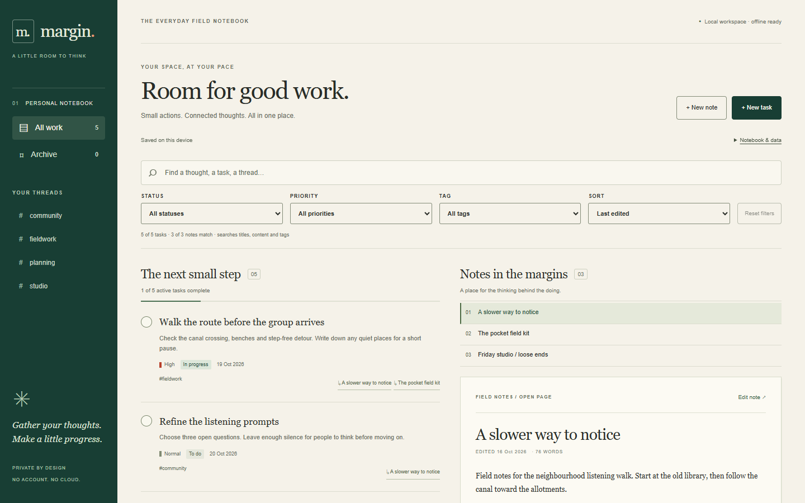
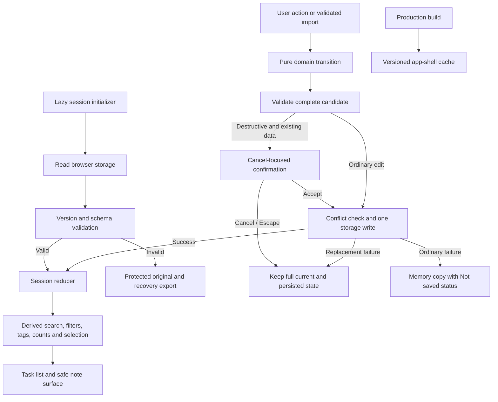

# Margin

A private task and notes notebook, built from new source and synthetic data for Zaheer Miah’s employer portfolio. An editorial layout pairs a task list with the thinking behind it: a warm paper surface, forest-green navigation, ruled separators and small vermilion priority marks.



## Run locally

Use Node **22.12 or newer** and npm. The recorded local run used Node 25.1.0 and npm 11.6.2. No account, environment file, backend or keys are needed.

```powershell
cd path/to/local-task-notes
npm ci --ignore-scripts
npm run dev
```

Open **http://127.0.0.1:4183**. Development mode serves local source and does not install the offline cache. To try offline reloads, stop the dev server, then use the production build:

```powershell
npm run build
npm run preview
```

Wait for **offline ready** in the header before disconnecting. The first load needs the local server; subsequent app-shell loads can work offline in the same browser and origin. Keep port 4183 available. The app never contacts a remote API or loads remote fonts, images or analytics.

## Use the notebook

- Create and edit tasks with details, status, priority, a date-only due date, tags and up to 30 linked notes. Complete or reopen a task with its circular control; edit status to mark it in progress.
- Write notes as plain text with a small Markdown subset: `#` and `##` headings, `-` lists and `>` quotes. All HTML, images, URLs and script-looking text remain inert text. Task links and note backlinks connect the two writing surfaces.
- Search both collections by title, content and tags. Space-separated terms must all match, even across different fields. Combine status, priority and tag filters, sort, inspect matching counts, or reset the view. Status and priority match tasks only; the interface explains why notes disappear under those filters.
- Use the Tasks/Notes panel controls on mobile; the filters disclosure leaves room for the notebook. Desktop shows both panels. Core actions work with a keyboard and require no dragging.
- Archive items without losing links, or delete them after confirmation. Deleting a note removes its task links in the same transition. Archive navigation includes notes as well as tasks.
- Use **Notebook & data** to export, import, reload the sample or start empty. Import, sample load and reset replace the entire notebook. Existing data always triggers a confirmation with Cancel initially focused. Cancel and Escape retain the current data and stored bytes.

The first visit shows five tasks and three notes about a fictional neighbourhood listening walk. This sample starts in memory and is saved with your first change; its status says so. Sample names, content, dates and identifiers are invented. No prior project, private repository or real account data was used.

## Local data, privacy and recovery

The complete workspace is one compact, schema-validated version 1 JSON value at `localStorage['margin.workspace.v1']`. Tags are derived from items and links are stored on tasks, so there are no independent stale tag/link collections. A successful save means this browser’s storage write completed; it does not mean a cloud backup exists.

Browser data can be removed by site-data clearing, private-session closure or browser policies. It is not encrypted. Anyone with access to this browser profile can read it. Keep regular JSON exports outside the browser. Changing the host or port creates a different storage origin; use export/import to transfer between them.

If stored JSON is malformed or uses an unsupported version, the app enters recovery mode and never overwrites it automatically. **Export original recovery** downloads the original stored string. Keep that file, repair a copy if possible, then import the repaired version. You may also explicitly replace the unreadable data with a sample or empty notebook after confirmation. There is no automatic migration or speculative repair.

If storage is denied or full, ordinary edits remain in memory and the app says **Not saved**. Export them before closing. A destructive replacement that cannot persist is rejected and leaves both the current notebook and its stored value intact. A save also checks whether another tab changed storage since this tab loaded it. On conflict, export this copy and reload to review the other copy. There is no automatic merge; simultaneous racing writes are a documented limitation of localStorage.

## Import contract

Import validates the whole file before showing a replacement confirmation. It accepts exactly `version`, `tasks` and `notes` at the root and exactly the documented fields per item. Unknown fields and prototype-related payload keys are rejected; no dynamic code evaluation, HTML insertion or object merging with untrusted property names is used.

| Boundary                                       | Limit                                                              |
| ---------------------------------------------- | ------------------------------------------------------------------ |
| UTF-8 file and compact workspace               | 1,000,000 bytes                                                    |
| Tasks / notes                                  | 500 / 200                                                          |
| Distinct tags across active and archived items | 50                                                                 |
| Title / body                                   | 160 / 20,000 UTF-16 code units                                     |
| Tags per item / tag length                     | 12 / 30 characters                                                 |
| Note links per task                            | 30                                                                 |
| ID                                             | 80 ASCII letters, digits, `_` or `-`; first character alphanumeric |
| Due date                                       | Valid Gregorian `YYYY-MM-DD`, 1900–2200, or `null`                 |
| Updated timestamp                              | Canonical UTC ISO timestamp, millisecond precision                 |

IDs are unique across tasks and notes. Duplicate tags/links, dangling note links and unsupported versions fail before any write. A replacement uses a single localStorage write, then a single reducer dispatch. Export retains all current item fields, including archived items, complete content, timestamps and note links. `src/domain.ts` defines the exact TypeScript schema; `src/demo.ts` is an importable concrete example.

## Architecture



Runtime dependencies are only matching React and React DOM. Vite handles the build; TypeScript and ESLint check source; Vitest tests the domain; Playwright runs one worker against the production build. Effects are limited to external lifecycle work. [React research and decisions](docs/react-research.md) records the Context Hub 19.2.6 guide and official references used.

## Verify

Run each command serially:

```powershell
npm test
npm run lint
npm run typecheck
npm run build
npm run format:check
npm run test:e2e
```

E2E defaults to **Playwright's bundled Chromium**, headlessly, with one worker. Install the browser revision matched to the locked Playwright version once before testing. Keep this downloaded browser inside the ignored project cache; no global installation is needed:

```powershell
$env:PLAYWRIGHT_BROWSERS_PATH = "$PWD/.cache/playwright"
npx playwright install chromium
npm run test:e2e
```

Use the same `PLAYWRIGHT_BROWSERS_PATH` setting in each new shell that runs the browser tests. With that setting, browser binaries stay under this checkout. Without it, Playwright looks in its normal per-user cache. On Linux/macOS the equivalent is `PLAYWRIGHT_BROWSERS_PATH="$PWD/.cache/playwright" npx playwright install chromium`, followed by `PLAYWRIGHT_BROWSERS_PATH="$PWD/.cache/playwright" npm run test:e2e`. OS browser prerequisites must already be available; no system packages were installed for this repair.

For an explicitly chosen **already installed** Chrome channel, set `$env:MARGIN_BROWSER_CHANNEL = "chrome"` before `npm run test:e2e`. That override requires local Google Chrome; it does not install it. Remove the override with `Remove-Item Env:MARGIN_BROWSER_CHANNEL -ErrorAction SilentlyContinue` to return to bundled Chromium. The clean-install verification uses the default with the override unset. [Playwright's browser documentation](https://playwright.dev/docs/browsers) explains supported channels and installations.

The authored GitHub Actions workflow runs these gates serially with Chromium. **No hosted CI run has been performed.** Nothing has been pushed or published. [Verification record](docs/verification.md) contains actual results and screenshot evidence.

## Optional backend documentation

The [Supabase setup/design guide](docs/supabase-setup.md), [schema proposal](docs/supabase-schema.sql) and [policy test examples](docs/supabase-policy-examples.sql) are **docs only — UNEXECUTED / NOT VERIFIED LIVE**. They describe tenant-owned tasks, notes and ownership-safe links, indexes and RLS for every CRUD operation. No backend setup, account, key, API adapter or sync behavior is implemented. The default app remains fully local and requires none of these files.

## Boundaries

- Single-browser local workspace; no sync, authentication, backend, telemetry or network service. No Supabase SDK or SQL is required to run it; optional SQL design documents are not executed.
- Markdown intentionally omits inline formatting, external links, images, tables and embedded HTML. Original text remains editable and exports intact.
- Native modal dialogs plus explicit Tab containment are tested in bundled Chromium (and previously installed Chrome). Real Safari, Firefox, assistive-technology sessions and physical mobile hardware have not been verified. Mobile tests use a 390×844 emulated viewport.
- Views, filters, selected note and open dialogs are transient; tasks, notes, tags, archive flags and links persist. Reload returns to the default view.
- The offline shell is production-only and caches local app assets, not notebook contents. A new build’s worker waits for existing tabs to close before activation; close all notebook tabs and reopen to update. If the cache install fails, the header does not claim offline readiness.
- Export is a backup, not encryption. No undo history is retained after confirmed deletion or replacement.

MIT © 2026 Zaheer Miah. Local commit author: `EdgeFlowAI <edgeflowai@proton.me>`.
